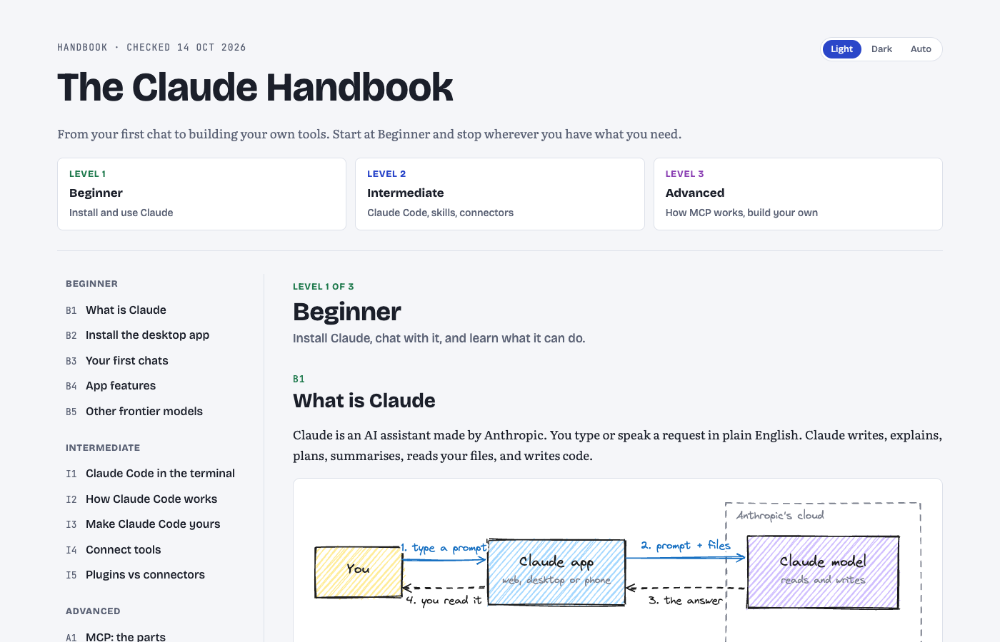

# The Claude Handbook

A three-level guide to Claude: install and use it, run Claude Code and connect your tools, and understand how MCP works inside, with hand-drawn diagrams throughout.

  

> **Read it online: [chethanbhatbs.github.io/claude-handbook](https://chethanbhatbs.github.io/claude-handbook/)**. No login, no download. Every chapter below links straight to its section.

---

## Chapters (18)

| Part | Chapters | Jump to |
|---|---:|---|
| **Beginner** | 5 | [B1 What is Claude](https://chethanbhatbs.github.io/claude-handbook/#what) · [B2 Install the desktop app](https://chethanbhatbs.github.io/claude-handbook/#desktop) · [B3 Your first chats](https://chethanbhatbs.github.io/claude-handbook/#first) · [B4 App features](https://chethanbhatbs.github.io/claude-handbook/#features) · [B5 Other frontier models](https://chethanbhatbs.github.io/claude-handbook/#models) |
| **Intermediate** | 5 | [I1 Claude Code in the terminal](https://chethanbhatbs.github.io/claude-handbook/#terminal) · [I2 How Claude Code works](https://chethanbhatbs.github.io/claude-handbook/#loop) · [I3 Make Claude Code yours](https://chethanbhatbs.github.io/claude-handbook/#customise) · [I4 Connect tools](https://chethanbhatbs.github.io/claude-handbook/#connect) · [I5 Plugins vs connectors](https://chethanbhatbs.github.io/claude-handbook/#plugins) |
| **Advanced** | 8 | [A1 MCP: the parts](https://chethanbhatbs.github.io/claude-handbook/#mcp-parts) · [A2 How a tool is defined](https://chethanbhatbs.github.io/claude-handbook/#tool-def) · [A3 How Claude uses a tool](https://chethanbhatbs.github.io/claude-handbook/#tool-flow) · [A4 Claude side or server side](https://chethanbhatbs.github.io/claude-handbook/#where) · [A5 MCP vs API](https://chethanbhatbs.github.io/claude-handbook/#vs-api) · [A6 Connect your own app](https://chethanbhatbs.github.io/claude-handbook/#your-app) · [A7 Automate Claude](https://chethanbhatbs.github.io/claude-handbook/#automate) · [A8 Word list](https://chethanbhatbs.github.io/claude-handbook/#words) |

---

## How to read

### 1 · In your browser
Open **[https://chethanbhatbs.github.io/claude-handbook/](https://chethanbhatbs.github.io/claude-handbook/)**, or click any chapter link above. The side menu jumps between chapters, and the switch in the top right changes between light and dark mode.

### 2 · On your phone
The page reflows for phone screens. Wide diagrams and tables scroll sideways inside their own box.

### 3 · Offline
Download [`index.html`](index.html) (it is one self-contained file) and open it in any browser. Fonts and the diagram library load from the internet the first time, so the very first open needs a connection.

---

## About the content

Facts were checked against official Anthropic, Claude Code and MCP docs on 14 Oct 2026. Products change quickly; each chapter names its source.

## Source and design

- `index.html` is the page itself, served by GitHub Pages. Every push to `main` redeploys it.
- `src/` holds the editable source.
- Diagrams are drawn with [rough.js](https://roughjs.com) in the Excalidraw style, using the Virgil font from [Excalidraw](https://github.com/excalidraw/excalidraw) (SIL Open Font License). Code examples are coloured with [Prism](https://prismjs.com).
